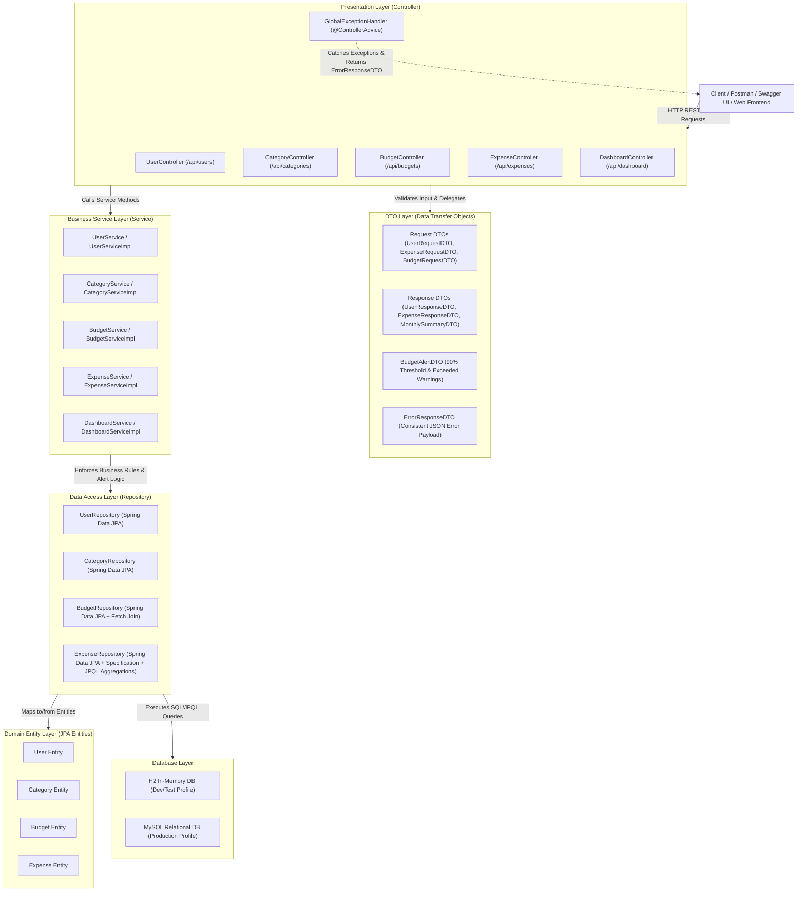

# ExpenseJar - Layered Architecture Diagram

This document details the strict layered architectural design of **ExpenseJar**, following high-cohesion, low-coupling principles, constructor dependency injection, DTO isolation, and centralized error handling.

## Architectural Design Principles

1. **Strict Layer Separation**: Controllers NEVER communicate directly with Repositories. All access passes through the Service layer.
2. **DTO Isolation**: Entities are strictly encapsulated within the backend persistence layer. REST controllers return and accept DTOs only, preventing internal database schema leaks.
3. **Constructor Injection**: All dependencies are injected via constructors (`final` fields) rather than field `@Autowired`, facilitating clean unit testing with Mockito.
4. **Declarative Transaction Management**: Service methods use `@Transactional` and `@Transactional(readOnly = true)` to ensure atomic operations and optimize database read performance.
5. **Centralized Error Handling**: `@ControllerAdvice` maps custom domain exceptions (`ResourceNotFoundException`, `InvalidExpenseException`, `DuplicateResourceException`) to consistent HTTP response codes (404, 400, 409) and JSON formats.
