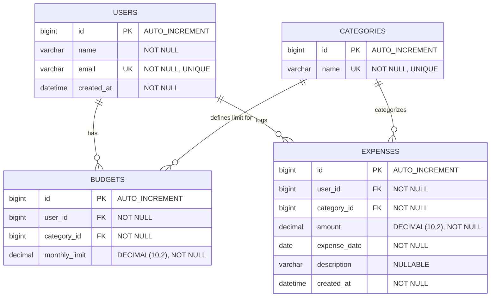

# ExpenseJar - Database Entity-Relationship (ER) Diagram

This document contains the Entity-Relationship (ER) diagram for the **ExpenseJar** personal expense tracking system, depicting entities, primary keys, foreign keys, constraints, and relationships.

## Relational Constraints & Indexes

1. **Unique Constraints**:
   - `users(email)`: Ensures no duplicate user registration.
   - `categories(name)`: Unique category names (e.g., Food, Travel, Stationery, Entertainment).
   - `budgets(user_id, category_id)`: Enforces a single monthly budget per category for each user.

2. **Indexes**:
   - `idx_expense_user_date` on `expenses(user_id, expense_date)`: Optimizes monthly spend aggregations, range queries, and trend calculations.
   - `idx_expense_user_cat` on `expenses(user_id, category_id)`: Speeds up category-filtered expense lookups and alert calculations.
   - `idx_budget_user_cat` on `budgets(user_id, category_id)`: Ensures fast retrieval during budget lookup and alert checks.
