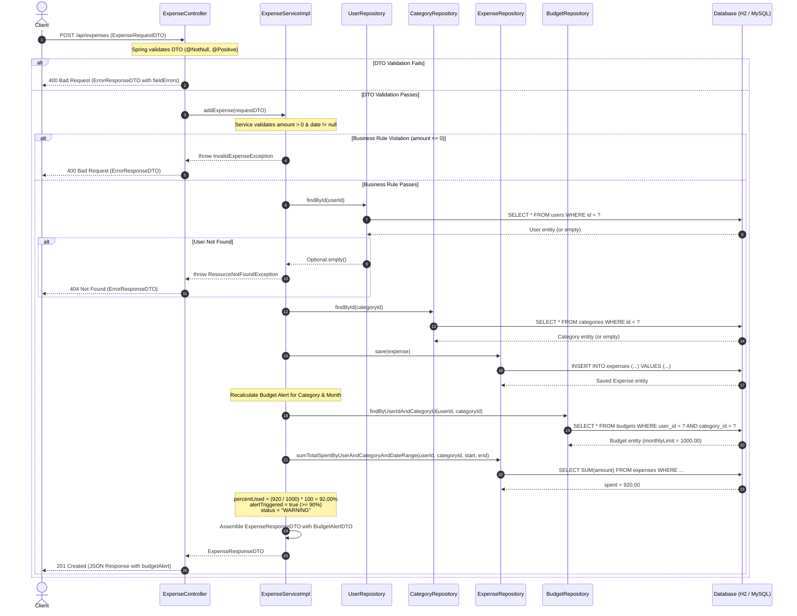

# ExpenseJar - Sequence Diagram: Add Expense & Alert Recalculation

This sequence diagram depicts the end-to-end execution flow when a client submits `POST /api/expenses`. It showcases DTO validation, service-layer business rules enforcement, database persistence, JPQL budget alert recalculation, and HTTP response assembly.

