# ExpenseJar - UML Class Diagram

This document provides the UML Class Diagram for the **ExpenseJar** backend, illustrating the layered architecture, relationships, controller-service-repository dependencies, DTO mappings, and custom exception handling.

```mermaid
classDiagram
    %% Controller Layer
    class ExpenseController {
        -ExpenseService expenseService
        +addExpense(ExpenseRequestDTO) ResponseEntity~ExpenseResponseDTO~
        +getExpenseById(Long) ResponseEntity~ExpenseResponseDTO~
        +getExpenses(...) ResponseEntity~Page~ExpenseResponseDTO~~
        +updateExpense(Long, ExpenseRequestDTO) ResponseEntity~ExpenseResponseDTO~
        +deleteExpense(Long) ResponseEntity~Void~
    }

    class UserController {
        -UserService userService
        -ExpenseService expenseService
        +createUser(UserRequestDTO) ResponseEntity~UserResponseDTO~
        +getUserById(Long) ResponseEntity~UserResponseDTO~
        +getAllUsers() ResponseEntity~List~UserResponseDTO~~
        +getCurrentMonthSummary(Long) ResponseEntity~MonthlySummaryDTO~
        +getBudgetAlerts(Long) ResponseEntity~List~BudgetAlertDTO~~
        +getMonthOverMonthTrend(Long, int) ResponseEntity~OverallTrendDTO~
    }

    class BudgetController {
        -BudgetService budgetService
        +setBudget(BudgetRequestDTO) ResponseEntity~BudgetResponseDTO~
        +getBudgetById(Long) ResponseEntity~BudgetResponseDTO~
        +getBudgetsByUserId(Long) ResponseEntity~List~BudgetResponseDTO~~
    }

    %% Service Layer Interfaces & Implementations
    class ExpenseService {
        <<interface>>
        +addExpense(ExpenseRequestDTO) ExpenseResponseDTO
        +getExpenseById(Long) ExpenseResponseDTO
        +getExpenses(...) Page~ExpenseResponseDTO~
        +updateExpense(Long, ExpenseRequestDTO) ExpenseResponseDTO
        +deleteExpense(Long) void
        +getCurrentMonthSummary(Long) MonthlySummaryDTO
        +getBudgetAlerts(Long) List~BudgetAlertDTO~
        +getMonthOverMonthTrend(Long, int) OverallTrendDTO
    }

    class ExpenseServiceImpl {
        -ExpenseRepository expenseRepository
        -UserRepository userRepository
        -CategoryRepository categoryRepository
        -BudgetRepository budgetRepository
        -double alertThresholdPercent
        +addExpense(ExpenseRequestDTO) ExpenseResponseDTO
        -calculateBudgetAlert(Long, Long, String, LocalDate) BudgetAlertDTO
        -validateExpenseRequest(ExpenseRequestDTO) void
    }

    %% Repository Layer
    class ExpenseRepository {
        <<interface>>
        +sumTotalSpentByUserAndCategoryAndDateRange(Long, Long, LocalDate, LocalDate) BigDecimal
        +sumCategorySpendByUserAndDateRange(Long, LocalDate, LocalDate) List~Object[]~
        +sumTotalSpentByUserAndDateRange(Long, LocalDate, LocalDate) BigDecimal
    }

    class BudgetRepository {
        <<interface>>
        +findByUserIdAndCategoryId(Long, Long) Optional~Budget~
        +findByUserId(Long) List~Budget~
    }

    %% Entities
    class User {
        -Long id
        -String name
        -String email
        -LocalDateTime createdAt
    }

    class Category {
        -Long id
        -String name
    }

    class Budget {
        -Long id
        -User user
        -Category category
        -BigDecimal monthlyLimit
    }

    class Expense {
        -Long id
        -User user
        -Category category
        -BigDecimal amount
        -LocalDate expenseDate
        -String description
        -LocalDateTime createdAt
    }

    %% DTOs
    class ExpenseRequestDTO {
        +Long userId
        +Long categoryId
        +BigDecimal amount
        +LocalDate expenseDate
        +String description
    }

    class ExpenseResponseDTO {
        +Long id
        +String userName
        +String categoryName
        +BigDecimal amount
        +LocalDate expenseDate
        +BudgetAlertDTO budgetAlert
    }

    class BudgetAlertDTO {
        +Long categoryId
        +String categoryName
        +BigDecimal monthlyLimit
        +BigDecimal spentAmount
        +BigDecimal percentUsed
        +boolean alertTriggered
        +String status
    }

    %% Relationships
    ExpenseController --> ExpenseService
    UserController --> UserService
    UserController --> ExpenseService
    BudgetController --> BudgetService

    ExpenseServiceImpl ..|> ExpenseService
    ExpenseServiceImpl --> ExpenseRepository
    ExpenseServiceImpl --> UserRepository
    ExpenseServiceImpl --> CategoryRepository
    ExpenseServiceImpl --> BudgetRepository

    Expense "1" --> "1" User : @ManyToOne
    Expense "1" --> "1" Category : @ManyToOne
    Budget "1" --> "1" User : @ManyToOne
    Budget "1" --> "1" Category : @ManyToOne

    ExpenseResponseDTO --> BudgetAlertDTO
```

